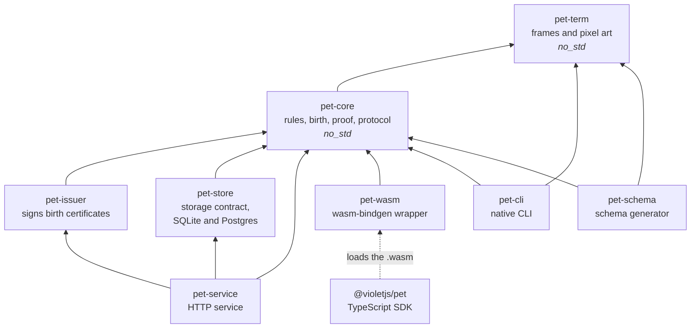
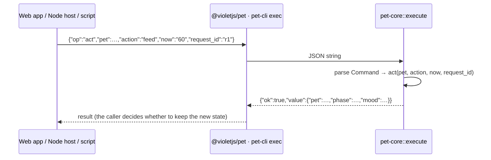
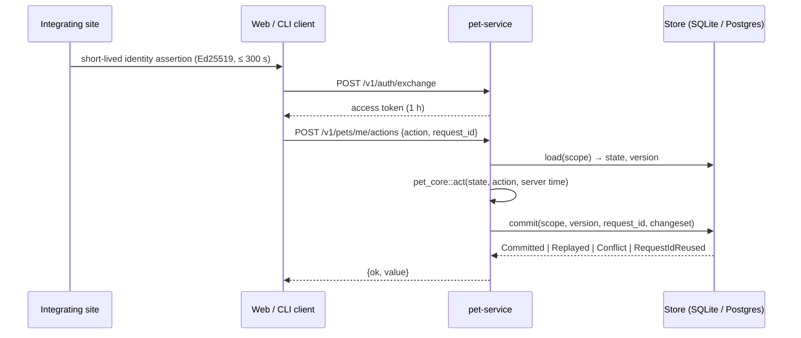

# Architecture

English | [简体中文](architecture.zh-CN.md)

This document describes how kodama is put together: the layers, which way dependencies point and why, how a command travels through the system, and which check enforces each guarantee. Product requirements are in [PRD-0036](prd/0036-独立电子宠物.md), domain terms in [CONTEXT.md](../CONTEXT.md), and the contract with integrating sites in [ADR-0021](adr/0021-pet-service-identity-and-activity-contract.md).

## Goals that shape the design

1. **One rules implementation, three runtimes, identical output.** Native code, browser WebAssembly and Node WebAssembly run the same Rust code and produce byte-identical transcripts. A birth must be recomputable by anyone.
2. **The rules core owns no clock, no randomness and no I/O.** Time and random material come in as parameters; the core returns decisions and new state, and never stores anything.
3. **No floating point in the rules.** Transcendental functions differ between native and WebAssembly, so integer-only arithmetic is a precondition, not a style choice.
4. **One source of truth for the wire protocol.** The JSON Schema, the TypeScript types, the capability catalog and the CLI help are all generated from the Rust types.
5. **Persistence is a contract, not a framework.** Storage is "load with version, then one atomic commit". Each backend proves the contract with the same tests.

## Layers



An arrow means "depends on". Every edge points toward the pure core at the top, and none of the crates `pet-service` builds on knows about HTTP, accounts or worlds.

| Crate / package | Owns | Does not own |
|---|---|---|
| `pet-term` | Character-cell frames (`frame`) and pixel art (`sprite`) for every species and pose; each species' body structure, which tests keep in sync with `catalog/species.json` | Rules, state, terminals (it only returns grids) |
| `pet-core` | Birth derivation, life and illness, growth and evolution, rewards, birth-certificate verification, error codes, the capability catalog, and the single JSON entry point `execute` | Clocks, randomness, storage, networking, signing keys |
| `pet-issuer` | Signing commitments and birth certificates with Ed25519 keys | Verification (that stays in the core so anyone can run it) |
| `pet-store` | The `Store` trait and its SQLite and Postgres implementations; `run_act`, which turns a core decision into one atomic commit | Rules, HTTP |
| `pet-service` | Accounts and worlds, identity-assertion exchange, access tokens, the commit-reveal birth flow, HTTP endpoints | Any data owned by an integrating site |
| `pet-wasm` | Exposing `execute` through wasm-bindgen | Anything else; it is seven lines long |
| `pet-cli` | `exec` (JSON lines), `live` (an animated pet in the terminal), `capabilities`, `version` | Account state; `live` is a local preview |
| `pet-schema` | Printing the JSON Schema of the wire protocol | Runtime behavior; it is a build-time tool |
| `@violetjs/pet` | Explicit async initialization, typed `run`, and terminal embedding for Node hosts | Rules; it only calls the WebAssembly |

### Dependency rules

`scripts/check-arch.mjs` (run by `make check-arch` and the CI Lint job) holds the allowed edges, and fails when:

- a crate depends on a workspace crate outside its allowed list (the table above);
- a new crate is added to the workspace without being registered;
- `pet-core` or `pet-term` gains a normal dependency outside the allowlist: digests (`sha2`, `hmac`), signature verification (`ed25519-dalek`), serialization (`serde`, `serde_json`), schema derivation (`schemars`, optional), and `pet-term` for the core;
- `pet-core` or `pet-term` loses `#![no_std]` or `#![forbid(unsafe_code)]`.

The same target then compiles both crates for `thumbv7em-none-eabihf`, a target with no standard library. A dependency that quietly pulls in `std` fails there, even though it would build fine for native targets and `wasm32-unknown-unknown`.

To add a crate or an edge, change the table in `scripts/check-arch.mjs` and this document in the same pull request.

## How a command flows

### Local mode: browser, Node, CLI



`execute(&str) -> String` is the only entry point shared by all three runtimes. Because input and output are both strings, the same transcript (`scenario/steps.json`) can be replayed through the native CLI, Node WebAssembly and web-target WebAssembly and compared byte for byte (`make three-end`).

### Account mode: the pet service



- **Scope** is `(world, owner)`. One service instance serves one world, so different sites never see each other's pets.
- **Time comes from the server.** Clients cannot choose a logical time in account mode.
- **Commits are atomic and idempotent.** State, inventory and the command result are written together. Replaying a `request_id` returns the stored result, and reusing it with different parameters is rejected. On a version conflict `run_act` reloads and retries, up to 16 times.
- **Births use commit-reveal.** The service commits to `server_seed` before the client adds its seed. The certificate, signed by `pet-issuer`, can be checked by `verify_birth` in any runtime against the keys published at `/v1/issuer-keys`.

The service never reads an integrating site's database or API; sites talk to it only through identity assertions, activity events and the SDK (ADR-0021).

## The wire protocol and generated files

```
Rust types (pet-core, pet-term) ──schemars──► pet-schema ──► schema/pet.schema.json
                                                               ├─► src/types.d.ts      (json-schema-to-typescript)
CAPABILITIES (pet-core::caps) ─────────────────────────────────┴─► docs/capabilities.md
                             └─► pet-cli help, the `capabilities` command, GET /v1/capabilities
```

Generated files are committed. `make schema` regenerates them, and `make schema-check` (CI Core job) fails if they are stale, validates real responses against the schema, and compiles positive and negative type tests. A new command has to be registered in `CAPABILITIES`, or the tests fail.

Encoding rules: 64-bit integers are decimal strings (JavaScript numbers lose precision above 2^53), every response is `{ok:true,value}` or `{ok:false,code,message}`, and callers branch on `code`.

## Determinism and compatibility

| Guarantee | How it is enforced |
|---|---|
| No floating point in the rules | `clippy::float_arithmetic = "deny"` for the core crates; the `no_floats` test |
| No std, no clock, no randomness in the core | `#![no_std]`, the no-std target build in `make check-arch`, and the dependency allowlist |
| Native, Node and web output agree | `make three-end` compares transcripts byte for byte (CI Core job) |
| Existing births never change | 16 golden birth vectors (`scenario/golden-births.json`); changing a derivation requires a new `rules_version` |
| Old pets are never guessed | `act` refuses an unsupported `rules_version` with `unsupported_rules` |
| Storage backends behave the same | One contract test suite runs against SQLite and Postgres, including concurrency |

Package versions and `rules_version` are separate: see [versioning](versioning.md).

## Verification map

| What | Local | CI job |
|---|---|---|
| Format, lint, architecture, versions, scripts, workflows, licenses | `make lint` | Lint |
| Rules, storage contract (SQLite and Postgres), HTTP layer | `make test test-pg` | Core |
| Three runtimes agree | `make three-end` | Core |
| Service end to end on a real binary | `make e2e-pg` | Core |
| Service image runs as non-root and answers | `make image-smoke` | Core; Release (both architectures) |
| Schema, types and docs are current | `make schema-check` | Core |
| Real TTY behavior | `make tty` | Core; Platform (linux-arm64, macOS) |
| Installed packages work outside the repository | `make consumers` | External consumption; Package |
| Release archives work on each target | `consumers/cli-archive.sh` | Package |
| The Docker dev environment works | `make docker-ci` | Dev environment (weekly) |
| Security advisories | `make deny` | Security (weekly) |

## Distribution

| Artifact | Channel |
|---|---|
| `@violetjs/pet` | npm |
| `pet-cli` | GitHub Release archives for Linux x64 and arm64 (static musl) and macOS arm64, with checksums and build provenance |
| `pet-service` | `ghcr.io/vod-studio/pet-service`, amd64 and arm64 |
| Crates | Not published yet (`publish = false`) |

All artifacts share one version and are released from one tag by `release.yml`. Details are in [distribution](distribution.md).

## Known coupling and planned changes

**`pet-core` depends on `pet-term`.** The protocol entry `execute` and the `Command` enum live in `pet-core`, and two commands (`frame`, `sprite`) dispatch to the renderer. The rules themselves do not use `pet-term`. A cleaner split would move `execute`, `Command` and the capability catalog into a protocol crate that depends on both. It is deferred on purpose. Today it would change no behavior: the crates are not published, unused code is already stripped from the `.wasm`, and output is unchanged. It would also break the crate API twice, because the crates will be renamed to `violet-pet-*` before publishing. Both changes will happen together when crates are first published. Until then, `check-arch` keeps the edge from spreading: no other crate may depend on `pet-term` except the CLI and the schema generator.

Other open items are tracked in the PRD and in [service](service.md) ("Known limitations"): token revocation, shared replay protection for multi-instance deployments, encryption of `server_seed` at rest, connection pooling, and rate limiting.

## Where to change what

| Change | Touch |
|---|---|
| A rule (growth, illness, rewards) | `crates/pet-core/src/{life,growth}.rs` and their tests; keep `make three-end` green; a change to existing results needs a new `rules_version` |
| A new command | `Command` and `execute` in `pet-core`, register it in `CAPABILITIES`, then `make schema` |
| Art for a species or pose | `crates/pet-term`, `catalog/species.json`; preview with `make preview` |
| A storage backend | Implement `Store` in `pet-store` and run the shared contract tests against it |
| An HTTP endpoint | `crates/pet-service/src/lib.rs` (router) and `tests/api.rs`; document it in [service](service.md) |
| A supported CLI platform | The `cli` matrix in `.github/workflows/package.yml`, the CLI README tables, and [distribution](distribution.md) |
