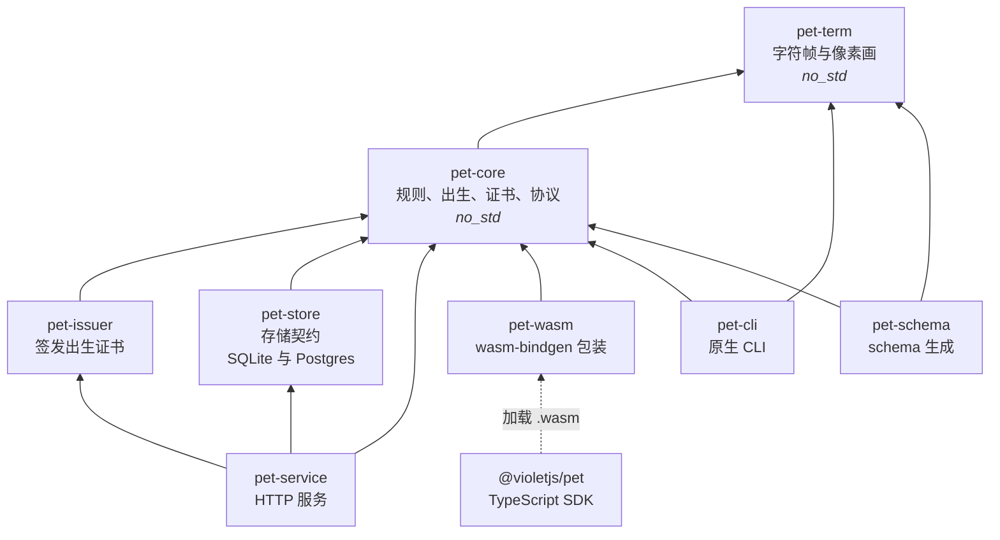
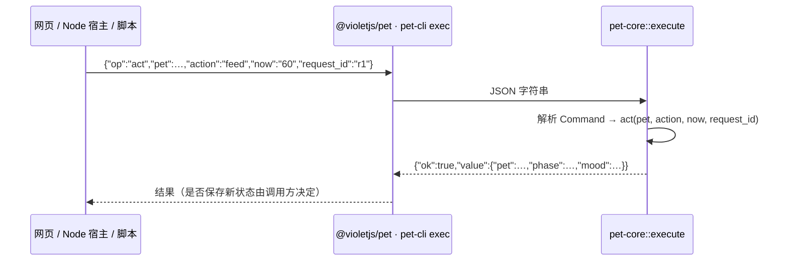
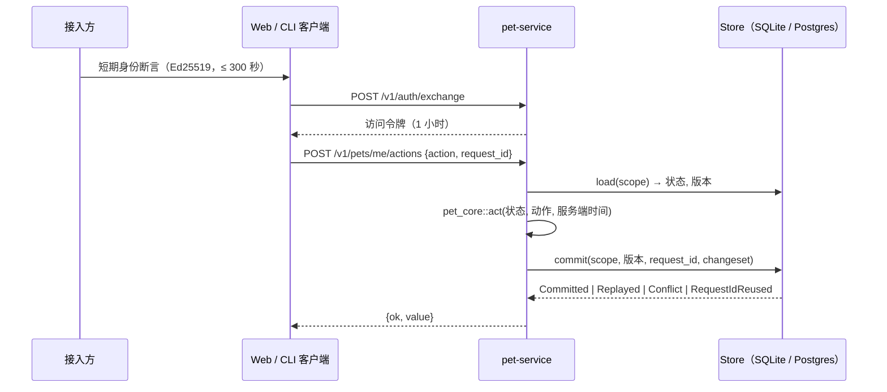

# 架构

[English](architecture.md) | 简体中文

本文说明 kodama 的组成：分哪几层、依赖朝哪个方向以及为什么、一条命令如何流经系统，以及每项保证由哪个检查强制。产品需求见 [PRD-0036](prd/0036-独立电子宠物.md)，领域术语见 [CONTEXT.md](../CONTEXT.md)，与接入方的契约见 [ADR-0021](adr/0021-pet-service-identity-and-activity-contract.md)。

## 决定设计的目标

1. **一份规则实现、三种运行环境、输出完全一致。** 原生、浏览器 WebAssembly 与 Node WebAssembly 运行同一份 Rust 代码，转录逐字节相同；任何人都能重算一次出生。
2. **规则核心不拥有时钟、随机源与 I/O。** 时间与随机材料作为参数传入；核心返回决定与新状态，自己不存储任何东西。
3. **规则里没有浮点。** 原生与 WebAssembly 的超越函数结果可能不同，只用整数是前提，而不是风格选择。
4. **线上协议只有一个事实源。** JSON Schema、TypeScript 类型、能力目录与 CLI 帮助都由 Rust 类型生成。
5. **持久化是契约，不是框架。** 存储只有「读取版本 + 单次原子提交」，每种后端都用同一套测试证明自己兑现了契约。

## 分层



箭头表示「依赖」。所有边都指向上方的纯核心；`pet-service` 所依赖的各层都不知道 HTTP、账号与世界的存在。

| crate / 包 | 负责 | 不负责 |
|---|---|---|
| `pet-term` | 所有物种与姿态的字符帧（`frame`）与像素画（`sprite`）；各物种的身体结构，由测试保证与 `assets/catalog/species.json` 一致 | 规则、状态、终端（只返回网格） |
| `pet-core` | 出生派生、生命与病程、成长与进化、奖励、出生证书核验、错误码、能力目录，以及唯一的 JSON 入口 `execute` | 时钟、随机源、存储、网络、签名密钥 |
| `pet-issuer` | 用 Ed25519 密钥签发承诺与出生证书 | 核验（留在核心里，任何人都能运行） |
| `pet-store` | `Store` trait 及其 SQLite、Postgres 实现；`run_act` 把核心的决定变成一次原子提交 | 规则、HTTP |
| `pet-service` | 账号与世界、身份断言兑换、访问令牌、承诺—揭示的出生流程、HTTP 接口 | 任何属于接入方的数据 |
| `pet-wasm` | 通过 wasm-bindgen 暴露 `execute` | 其他一切；它只有七行 |
| `pet-cli` | `exec`（JSON 行）、`live`（终端里的动态宠物）、`capabilities`、`version` | 账号状态；`live` 只是本地预览 |
| `pet-schema` | 输出线上协议的 JSON Schema | 运行时行为；它是构建期工具 |
| `@violetjs/pet` | 显式异步初始化、强类型的 `run`、给 Node 宿主的终端嵌入 | 规则；它只调用 WebAssembly |

### 依赖规则

`scripts/check/check-arch.mjs`（由 `make check-arch` 与 CI 的 Lint 作业运行）保存允许的依赖边，以下情况会失败：

- crate 依赖了允许列表（上表）之外的 workspace crate；
- workspace 新增了 crate 却没有登记；
- `pet-core` 或 `pet-term` 增加了允许范围之外的正常依赖。允许的是：摘要（`sha2`、`hmac`）、签名验证（`ed25519-dalek`）、序列化（`serde`、`serde_json`）、schema 派生（`schemars`，可选），以及核心对 `pet-term` 的依赖；
- `pet-core` 或 `pet-term` 去掉了 `#![no_std]` 或 `#![forbid(unsafe_code)]`。

同一目标随后在 `thumbv7em-none-eabihf`（没有标准库的目标）上编译这两个 crate。悄悄引入 `std` 的依赖在原生与 `wasm32-unknown-unknown` 上都能编译通过，在这里会失败。

新增 crate 或依赖边时，在同一个 PR 里修改 `scripts/check/check-arch.mjs` 的表与本文。

## 命令如何流经系统

### 本地模式：浏览器、Node、CLI



`execute(&str) -> String` 是三种运行环境共用的唯一入口。输入输出都是字符串，因此同一份转录（`tests/fixtures/steps.json`）可以分别经原生 CLI、Node WebAssembly 与 web target 的 WebAssembly 重放并逐字节比较（`make three-end`）。

### 账号模式：宠物服务



- **作用域**是 `(world, owner)`。一个服务实例对应一个世界，不同接入方互相看不到对方的宠物。
- **时间由服务端决定。** 账号模式下客户端不能指定逻辑时间。
- **提交原子且幂等。** 状态、库存与命令结果一起写入；重放同一个 `request_id` 返回已保存的结果，同一个标识换参数会被拒绝；版本冲突时 `run_act` 重新读取并重试，最多 16 次。
- **出生使用承诺—揭示。** 服务在客户端加入随机材料之前先承诺 `server_seed`；由 `pet-issuer` 签发的证书可以在任何运行环境里用 `verify_birth` 对照 `/v1/issuer-keys` 公布的公钥核验。

服务从不读取接入方的数据库或 API；接入方只通过身份断言、活动事件与 SDK 与它交互（ADR-0021）。

## 线上协议与生成文件

```
Rust 类型（pet-core、pet-term）──schemars──► pet-schema ──► schema/pet.schema.json
                                                             ├─► src/types.d.ts      （json-schema-to-typescript）
CAPABILITIES（pet-core::caps）───────────────────────────────┴─► docs/capabilities.md
                             └─► pet-cli help、capabilities 命令、GET /v1/capabilities
```

生成的文件随仓库提交。`make schema` 重新生成；`make schema-check`（CI 的 Core 作业）在生成物过期时失败，用 schema 校验真实响应，并编译正反两组类型测试。新增命令必须在 `CAPABILITIES` 登记，否则测试失败。

编码规则：64 位整数编码为十进制字符串（JavaScript 的 number 超过 2^53 会失去精度）；每个响应都是 `{ok:true,value}` 或 `{ok:false,code,message}`，调用方按 `code` 分支。

## 确定性与兼容

| 保证 | 如何强制 |
|---|---|
| 规则里没有浮点 | 核心 crate 启用 `clippy::float_arithmetic = "deny"`；`no_floats` 测试 |
| 核心不依赖 std、时钟与随机源 | `#![no_std]`、`make check-arch` 的无 std 目标编译、依赖允许列表 |
| 原生、Node、web 输出一致 | `make three-end` 逐字节比较转录（CI 的 Core 作业） |
| 既有出生永不改变 | 16 组黄金出生向量（`tests/fixtures/golden-births.json`）；改变派生必须提升 `rules_version` |
| 不猜测旧个体的规则 | `act` 遇到不支持的 `rules_version` 返回 `unsupported_rules` |
| 各存储后端行为一致 | 同一套契约测试分别对 SQLite 与 Postgres 运行，包括并发 |

包版本与 `rules_version` 相互独立，见[版本策略](design/versioning.md)。

## 验证对照

| 验证什么 | 本地 | CI 作业 |
|---|---|---|
| 格式、lint、架构、版本、脚本、工作流、许可 | `make lint` | Lint |
| 规则、存储契约（SQLite 与 Postgres）、HTTP 层 | `make test test-pg` | Core |
| 三端一致 | `make three-end` | Core |
| 真实二进制上的服务端到端 | `make e2e-pg` | Core |
| 服务镜像以非 root 运行并应答 | `make image-smoke` | Core；Release（两种架构） |
| schema、类型与文档未过期 | `make schema-check` | Core |
| 真实 TTY 行为 | `make tty` | Core；Platform（linux-arm64、macOS） |
| 安装后的包在仓库外可用 | `make consumers` | External consumption；Package |
| 每个发布归档在对应平台可用 | `tests/consumers/cli-archive/run.sh` | Package |
| Docker 开发环境可用 | `make docker-ci` | Dev environment（每周） |
| 安全公告 | `make deny` | Security（每周） |

## 分发

| 产物 | 渠道 |
|---|---|
| `@violetjs/pet` | npm |
| `pet-cli` | GitHub Release 归档：Linux x64、arm64（musl 静态链接）与 macOS arm64，带校验和与构建来源证明 |
| `pet-service` | `ghcr.io/vod-studio/pet-service`，amd64 与 arm64 |
| crates | 暂不发布（`publish = false`） |

所有产物共用一个版本号，由 `release.yml` 从同一个标签发布。详见[分发](operations/distribution.md)。

## 已知耦合与计划中的调整

**`pet-core` 依赖 `pet-term`。** 协议入口 `execute` 与 `Command` 枚举在 `pet-core` 里，其中两个命令（`frame`、`sprite`）分派给渲染；规则本身并不使用 `pet-term`。更干净的拆法是把 `execute`、`Command` 与能力目录移到一个同时依赖两者的协议 crate。这一步是有意推迟的：现在拆不改变任何行为（crate 不发布，`.wasm` 里没用到的代码本来就被裁掉，输出不变）；而且 crate 发布前还要改名为 `violet-pet-*`，现在拆会让 crate 的接口破坏两次。两件事留到首次发布 crate 时一起做。在那之前，`check-arch` 保证这条边不扩散：除 CLI 与 schema 生成器外，其他 crate 都不能依赖 `pet-term`。

其他未完成项记录在 PRD 与[服务说明](operations/service.md)的「已知限制」里：令牌撤销、多实例部署的共享重放防护、`server_seed` 静态加密、连接池与速率限制。

## 改什么动哪里

| 改动 | 涉及 |
|---|---|
| 规则（成长、病程、奖励） | `crates/core/pet-core/src/{life,growth}.rs` 及其测试；保持 `make three-end` 通过；改变既有结果需要新的 `rules_version` |
| 新命令 | `pet-core` 的 `Command` 与 `execute`，在 `CAPABILITIES` 登记，然后 `make schema` |
| 物种或姿态的画面 | `crates/core/pet-term`、`assets/catalog/species.json`；用 `make preview` 预览 |
| 存储后端 | 在 `pet-store` 实现 `Store`，并对它运行共享的契约测试 |
| HTTP 接口 | `crates/service/pet-service/src/lib.rs`（路由）与 `tests/api.rs`；在[服务说明](operations/service.md)里记录 |
| CLI 支持的平台 | `.github/workflows/package.yml` 的 `cli` 矩阵、CLI README 的平台表、[分发](operations/distribution.md) |
