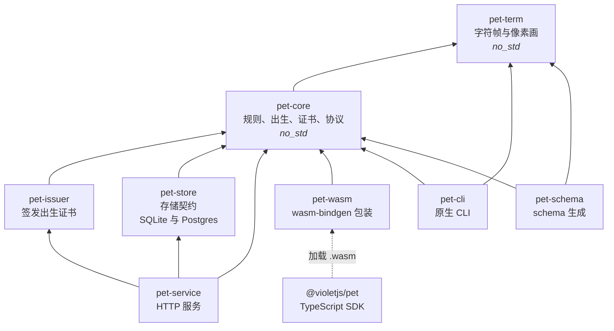
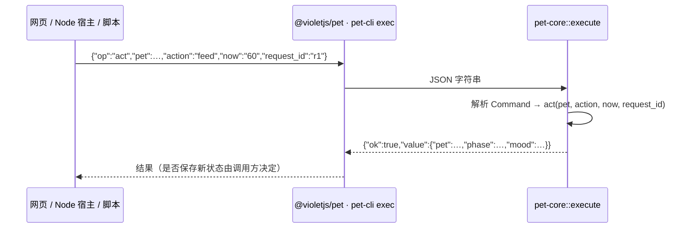
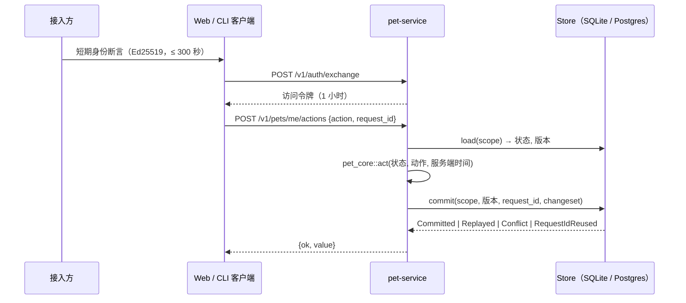

# 架构

[English](architecture.md) | 简体中文

本文说明 kodama 的组成：分哪几层、依赖朝哪个方向以及为什么、一条命令如何流经系统，以及每项保证由哪个检查强制。产品需求见 [PRD-0036](prd/0036-独立电子宠物.md)，领域术语见 [CONTEXT.md](../CONTEXT.md)，与接入方的契约见 [ADR-0021](adr/0021-pet-service-identity-and-activity-contract.md)。

## 决定设计的目标

1. **一份规则实现、三种运行环境、输出完全一致。** 原生、浏览器 WebAssembly 与 Node WebAssembly 运行同一份 Rust 代码，转录逐字节相同；任何人都能重算一次出生。
2. **规则核心不拥有时钟、随机源与 I/O。** 时间与随机材料作为参数传入；核心返回决定与新状态，自己不存储任何东西。
3. **规则里没有浮点。** 原生与 WebAssembly 的超越函数结果可能不同，只用整数是前提，而不是风格选择。
4. **线上协议只有一个事实源。** JSON Schema、TypeScript 类型、能力目录与 CLI 帮助都由 Rust 类型生成。
5. **持久化是契约，不是框架。** 存储只有「读取版本 + 单次原子提交」，每种后端都用同一套测试证明自己兑现了契约。

## 分层



箭头表示「依赖」。所有边都指向上方的纯核心；`pet-service` 所依赖的各层都不知道 HTTP、账号与世界的存在。

| crate / 包 | 负责 | 不负责 |
|---|---|---|
| `pet-term` | 所有物种与姿态的字符帧（`frame`）与像素画（`sprite`）；各物种的身体结构，由测试保证与 `assets/catalog/species.json` 一致 | 规则、状态、终端（只返回网格） |
| `pet-core` | 出生派生、生命与病程、成长与进化、奖励、出生证书核验、错误码、能力目录，以及唯一的 JSON 入口 `execute` | 时钟、随机源、存储、网络、签名密钥 |
| `pet-issuer` | 用 Ed25519 密钥签发承诺与出生证书 | 核验（留在核心里，任何人都能运行） |
| `pet-store` | `Store` trait 及其 SQLite、Postgres 实现；`run_act` 把核心的决定变成一次原子提交 | 规则、HTTP |
| `pet-service` | 账号与世界、身份断言兑换、访问令牌、承诺—揭示的出生流程、HTTP 接口 | 任何属于接入方的数据 |
| `pet-wasm` | 通过 wasm-bindgen 暴露 `execute` | 其他一切；它只有七行 |
| `pet-cli` | `exec`（JSON 行）、`live`（终端里的动态宠物）、`capabilities`、`version` | 账号状态；`live` 只是本地预览 |
| `pet-schema` | 输出线上协议的 JSON Schema | 运行时行为；它是构建期工具 |
| `@violetjs/pet` | 显式异步初始化、强类型的 `run`、画布与终端呈现、本地模式（与 `pet-store` 同一契约的 IndexedDB 存储） | 规则；它只调用 WebAssembly |

### 依赖规则

目录即分层：每个 crate 位于 `crates/<层>/<crate>`，workspace 包含 `crates/*/*`。crate 之间的路径只在根 `Cargo.toml` 的 `[workspace.dependencies]` 声明一次，成员写 `pet-core = { workspace = true }`。

| 层 | crate | 可以依赖 |
|---|---|---|
| `core` | `pet-core`、`pet-term` | 只有 `core`。`no_std`，不读时钟、不取随机源、不做 I/O |
| `service` | `pet-store`、`pet-issuer`、`pet-service` | `core`、`service` |
| `runtimes` | `pet-cli`、`pet-wasm` | `core` |
| `tools` | `pet-schema` | `core` |

`scripts/check/check-arch.mjs`（由 `make check-arch` 与 CI 的 Lint 作业运行）在以下情况失败：

- crate 不在 `crates/<它的层>/<它的名字>`，或新增 crate 没有登记；
- crate 依赖了上表不允许的层，或依赖了自己白名单之外的 workspace crate；
- `pet-core` 或 `pet-term` 增加了核心允许范围之外的正常依赖。允许的是：摘要（`sha2`、`hmac`）、签名验证（`ed25519-dalek`）、序列化（`serde`、`serde_json`）、schema 派生（`schemars`，可选）；
- `pet-core` 或 `pet-term` 去掉了 `#![no_std]` 或 `#![forbid(unsafe_code)]`。

同一目标随后在 `thumbv7em-none-eabihf`（没有标准库的目标）上编译核心层。悄悄引入 `std` 的依赖在原生与 `wasm32-unknown-unknown` 上都能编译通过，在这里会失败。

新增 crate 或依赖边时，在同一个 PR 里修改 `scripts/check/check-arch.mjs` 与本文。

### crate 内部

`pet-core` 与 `pet-service` 按职责分模块，每个新功能都有固定的位置，而不是让一个文件越长越大：

```
crates/core/pet-core/src/
├── protocol/   execute、Command、编码、能力目录。日后拆成独立协议 crate 的边界
├── birth/      出生派生；proof.rs 核验证书
├── rules/      life.rs（需求、病程、死亡）、growth.rs（等级、性格、进化）、wardrobe.rs（装扮）
└── rng.rs      HKDF 随机通道；每个功能各用一条带标签的独立通道

crates/service/pet-service/src/
├── lib.rs      路由表：全部接口的唯一清单
├── state.rs    Config、AppState
├── error.rs    {ok, value} / {ok:false, code, message} 响应格式
├── http.rs     认证、请求体解析、作用域、把存储操作移出异步运行时
├── identity.rs 身份断言与访问令牌
├── activity.rs 活动事实：签名校验、奖励表、每日账本
├── session.rs  登录会话：刷新令牌轮换，重用即撤销会话
├── device.rs   设备授权（CLI 登录）：用户码与授权记录
├── record.rs   存储契约上小 JSON 记录的读改写
└── routes/     按资源分文件：meta、auth、births、pets、sessions、device、activity
```

公开路径不随内部结构变化：其他 crate 用到的一切都由 `pet_core` 再导出。

## 目录结构

```
kodama/
├── crates/<层>/<crate>/      Rust，按层分组（见上文）
├── packages/<包>/            npm 包：pet-sdk 即 @violetjs/pet
├── assets/                   美术及其记录：目前是 catalog/species.json
├── tests/                    跨组件验收，按类型分组
│   ├── fixtures/             黄金出生向量、场景步骤、证书及其生成脚本
│   ├── parity/               原生、Node、web 输出必须逐字节一致
│   ├── tty/                  pet-cli live 在真实终端里的行为
│   ├── e2e/                  服务二进制经真实 HTTP，SQLite 与 Postgres
│   ├── consumers/<名称>/     在仓库外使用安装后的产物；每个都有 run.sh
│   └── bench/
├── scripts/
│   ├── dev/                  本地开发：dev.mjs、with-postgres.sh
│   ├── check/                仓库检查：check-arch.mjs、version.mjs
│   └── release/              打包与发布
├── docker/                   dev.Dockerfile、service.Dockerfile（各带自己的 .dockerignore）、compose.yaml
├── docs/
│   ├── architecture(.zh-CN).md
│   ├── prd/ adr/ research/   产品需求、决策记录、调研
│   ├── design/               规则与协议：参数、成长、版本、出生协议、本地模式、扩展玩法、素材、装扮
│   ├── operations/           服务运行、分发与发版
│   └── history/              过去的变更记录，如仓库拆分
└── .github/                  工作流、dependabot、release-please 配置与清单
```

根目录只放工具要求必须在根目录的文件（`Cargo.toml`、`Cargo.lock`、`rustfmt.toml`、`deny.toml`、各类点文件）、入口文件（`Makefile`、README、CONTRIBUTING、CHANGELOG、`CONTEXT.md`、LICENSE）与上面这些目录。`check-arch` 用白名单强制这一点，并拒绝直接散落在 `crates/`、`crates/<层>/`、`tests/`、`scripts/`、`packages/` 下的文件。单元测试留在代码旁（`crates/**/tests/`）；`tests/` 只放跨多个组件或针对安装后产物的检查。

## 命令如何流经系统

### 本地模式：浏览器、Node、CLI



`execute(&str) -> String` 是三种运行环境共用的唯一入口。输入输出都是字符串，因此同一份转录（`tests/fixtures/steps.json`）可以分别经原生 CLI、Node WebAssembly 与 web target 的 WebAssembly 重放并逐字节比较（`make three-end`）。

### 账号模式：宠物服务



- **作用域**是 `(world, owner)`。一个服务实例对应一个世界，不同接入方互相看不到对方的宠物。
- **时间由服务端决定。** 账号模式下客户端不能指定逻辑时间。
- **提交原子且幂等。** 状态、库存与命令结果一起写入；重放同一个 `request_id` 返回已保存的结果，同一个标识换参数会被拒绝；版本冲突时 `run_act` 重新读取并重试，最多 16 次。
- **出生使用承诺—揭示。** 服务在客户端加入随机材料之前先承诺 `server_seed`；由 `pet-issuer` 签发的证书可以在任何运行环境里用 `verify_birth` 对照 `/v1/issuer-keys` 公布的公钥核验。

服务从不读取接入方的数据库或 API；接入方只通过身份断言、活动事件与 SDK 与它交互（ADR-0021）。

## 线上协议与生成文件

```
Rust 类型（pet-core、pet-term）──schemars──► pet-schema ──► schema/pet.schema.json
                                                             ├─► src/types.d.ts      （json-schema-to-typescript）
CAPABILITIES（pet-core::caps）───────────────────────────────┴─► docs/capabilities.md
                             └─► pet-cli help、capabilities 命令、GET /v1/capabilities
```

生成的文件随仓库提交。`make schema` 重新生成；`make schema-check`（CI 的 Core 作业）在生成物过期时失败，用 schema 校验真实响应，并编译正反两组类型测试。新增命令必须在 `CAPABILITIES` 登记，否则测试失败。

编码规则：64 位整数编码为十进制字符串（JavaScript 的 number 超过 2^53 会失去精度）；每个响应都是 `{ok:true,value}` 或 `{ok:false,code,message}`，调用方按 `code` 分支。

## 确定性与兼容

| 保证 | 如何强制 |
|---|---|
| 规则里没有浮点 | 核心 crate 启用 `clippy::float_arithmetic = "deny"`；`no_floats` 测试 |
| 核心不依赖 std、时钟与随机源 | `#![no_std]`、`make check-arch` 的无 std 目标编译、依赖允许列表 |
| 原生、Node、web 输出一致 | `make three-end` 逐字节比较转录（CI 的 Core 作业） |
| 既有出生永不改变 | 16 组黄金出生向量（`tests/fixtures/golden-births.json`）；改变派生必须提升 `rules_version` |
| 不猜测旧个体的规则 | `act` 遇到不支持的 `rules_version` 返回 `unsupported_rules` |
| 各存储后端行为一致 | 同一套契约测试分别对 SQLite 与 Postgres 运行，包括并发；其中的共享向量（`tests/fixtures/store-contract.json`）也对 SDK 的内存与 IndexedDB 存储运行 |

包版本与 `rules_version` 相互独立，见[版本策略](design/versioning.md)。

## 验证对照

| 验证什么 | 本地 | CI 作业 |
|---|---|---|
| 格式、lint、架构、版本、脚本、工作流、许可 | `make lint` | Lint |
| 规则、存储契约（SQLite 与 Postgres）、HTTP 层 | `make test test-pg` | Core |
| 三端一致 | `make three-end` | Core |
| 真实二进制上的服务端到端 | `make e2e-pg` | Core |
| 服务镜像以非 root 运行并应答 | `make image-smoke` | Core；Release（两种架构） |
| schema、类型与文档未过期 | `make schema-check` | Core |
| SDK 网页渲染与本地模式：生命周期、无障碍、存储契约、回滚、多标签页 | `make sdk-test` | Core |
| 真实 TTY 行为 | `make tty` | Core；Platform（linux-arm64、macOS） |
| 安装后的包在仓库外可用 | `make consumers` | External consumption；Package |
| 每个发布归档在对应平台可用 | `tests/consumers/cli-archive/run.sh` | Package |
| Docker 开发环境可用 | `make docker-ci` | Dev environment（每周） |
| 安全公告 | `make deny` | Security（每周） |

## 分发

| 产物 | 渠道 |
|---|---|
| `@violetjs/pet` | npm |
| `pet-cli` | GitHub Release 归档：Linux x64、arm64（musl 静态链接）与 macOS arm64，带校验和与构建来源证明 |
| `pet-service` | `ghcr.io/vod-studio/pet-service`，amd64 与 arm64 |
| crates | 暂不发布（`publish = false`） |

所有产物共用一个版本号，由 `release.yml` 从同一个标签发布。详见[分发](operations/distribution.md)。

## 已知耦合与计划中的调整

**`pet-core` 依赖 `pet-term`。** 协议入口 `execute` 与 `Command` 枚举在 `pet-core` 里（现为独立的 `protocol` 模块），其中两个命令（`frame`、`sprite`）分派给渲染；规则本身并不使用 `pet-term`。把 `protocol/` 移成独立 crate 是有意推迟的：现在拆不改变任何行为（crate 不发布，`.wasm` 里没用到的代码本来就被裁掉，输出不变）；而且 crate 发布前还要改名为 `violet-pet-*`，现在拆会让接口破坏两次。两件事留到首次发布 crate 时一起做。在那之前，模块边界与 `check-arch` 保证这条边不扩散。

其他未完成项记录在 PRD 与[服务说明](operations/service.md)的「已知限制」里：令牌撤销、多实例部署的共享重放防护、`server_seed` 静态加密、连接池与速率限制。

## 规划中的功能落在哪里

每个未完成的 issue 在这套结构里都已有位置。功能按下表新增模块，实现之后才在能力目录登记命令。

| issue | 规则（`pet-core`） | 美术（`pet-term`、`assets/`） | 服务（`pet-service`、`pet-store`） | 客户端 |
|---|---|---|---|---|
| 进化形态与精细画风（#6、#11、#14） | `rules/growth.rs`：条件不变；`Stage` 与 `Branch` 在 `pet_term::form` | **像素画风已完成**（[设计](design/evolution.md)）：每阶段一副身体、分支特征、每物种 16 种外形，名称在 `assets/catalog/`；终端以半格字符绘制同一套像素画（`charset: "blocks"`） | 入口仍是 `GET /v1/pets/me/evolution` | SDK 把 `lineage` 传给 `sprite` |
| #5 规则版本迁移 | `rules/migrate.rs`：显式的 `migrate(pet, from, to)` 与不变量测试 | — | 加载时迁移并持久化；表结构变更以编号迁移放在 `pet-store` | — |
| #10 账号服务 | — | — | **登录会话已完成**：`session.rs`（刷新令牌轮换、重用即撤销）、`record.rs`（存储契约上的小记录）；连接池已完成；待做：速率限制、固化存储契约签名 | — |
| #12 活动与奖励 | `grant`（已有） | — | **已完成**：`activity.rs`（签名、奖励表、每日账本）与 `routes/activity.rs`（收件 → 预留 → 发放，按资格去重）；`pet-store` 的 `run_grant` | 接入方的连接器发送签名事件 |
| #13 浏览器本地模式 | 不变 | — | 契约向量（`tests/fixtures/store-contract.json`）也对 SQLite 与 Postgres 运行 | **已完成**（[设计](design/local-mode.md)）：`@violetjs/pet/local` 与 `/store`，IndexedDB 存储、每日口粮与活动奖励、多标签页并发 |
| #15 CLI 账号 | — | — | **已完成**：设备授权 `device.rs` 与 `routes/device.rs`（[说明](operations/service.md#登录会话与设备授权)）；投影带上外形 | **已完成**：`pet-cli` 的 `account/`（登录、凭据、自动刷新、`live --account`），经 HTTP 访问，不链接服务端 crate |
| #16 Skill | 能力目录（已有） | — | — | `packages/pet-sdk/skill/`，可生成部分由能力目录产出 |
| #17 装扮与家园 | **已完成**：`rules/wardrobe.rs`（升级解锁、穿脱、身体结构检查），`Pet.species` | **已完成**：`pet-term` 的 `outfit.rs` 与 `pixel/items.rs`，`assets/catalog/items.json`（[设计](design/outfits.md)） | 动作经 `POST /v1/pets/me/actions`，无需新接口 | `sprite`、`frame`、`mountPet` 与终端嵌入接受 `outfit` |
| #18 主题探险 | `rules/expedition.rs`：独立随机通道 | 见闻收藏品素材 | `routes/expeditions.rs`、每日上限 | — |
| #19 好友 | 只有公开投影 | — | `routes/friends.rs`：双方确认与撤回，自有数据表 | — |
| #20 繁育与家谱 | `birth/inherit.rs`：遗传与变异用独立通道；家谱进入证书上下文 | 遗传特征体现在形态上 | `routes/breeding.rs`：两步授权、孵化仓、退役 | — |
| #21 AI 对话 | 能力白名单来自能力目录 | — | `routes/chat.rs`；模型接入在新的 `service` 层 crate 里以 trait 抽象，HTTP 客户端依赖保持可选 | — |
| #7 身份与活动协议 | — | — | 由 `pet-schema` 生成 HTTP 接口的 JSON Schema，与命令协议同法 | 连接器在接入方仓库 |

新的顶层目录（例如 #14 网页演示用的 `apps/`）在引入它的 PR 里加入 `check-arch` 的白名单。

## 改什么动哪里

| 改动 | 涉及 |
|---|---|
| 规则（成长、病程、奖励） | `crates/core/pet-core/src/rules/` 与 `crates/core/pet-core/tests/` 里的测试；保持 `make three-end` 通过；改变既有结果需要新的 `rules_version` |
| 新命令 | `crates/core/pet-core/src/protocol/mod.rs` 的 `Command` 与 `execute`，在 `protocol/caps.rs` 登记，然后 `make schema` |
| 物种或姿态的画面 | `crates/core/pet-term`、`assets/catalog/species.json`；用 `make preview` 预览 |
| 存储后端 | 在 `pet-store` 实现 `Store`，并对它运行共享的契约测试 |
| HTTP 接口 | `crates/service/pet-service/src/routes/` 里的处理函数、`lib.rs` 路由表里的一行、`tests/api.rs` 的测试；在[服务说明](operations/service.md)里记录 |
| 跨组件检查 | `tests/` 下新建目录与 `run.sh`，加 `make` 目标与 CI 步骤 |
| CLI 支持的平台 | `.github/workflows/package.yml` 的 `cli` 矩阵、CLI README 的平台表、[分发](operations/distribution.md) |
